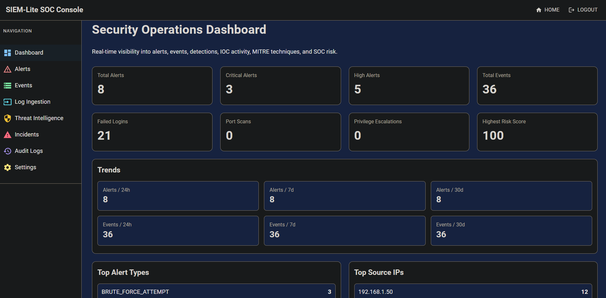
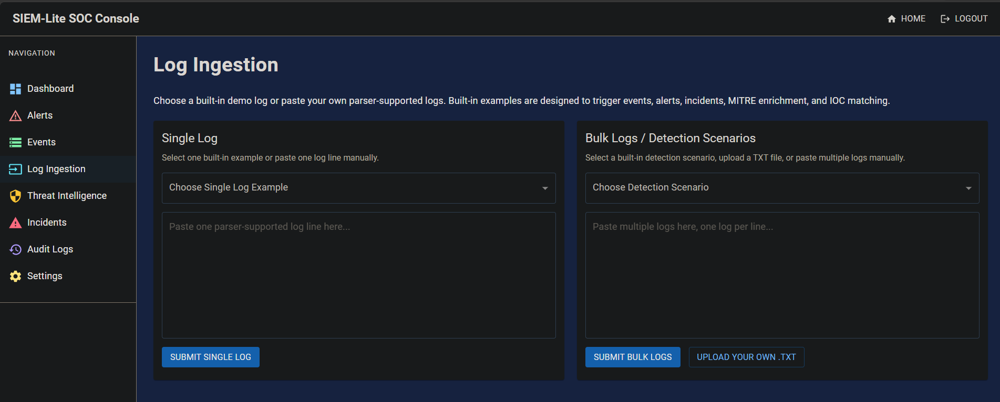
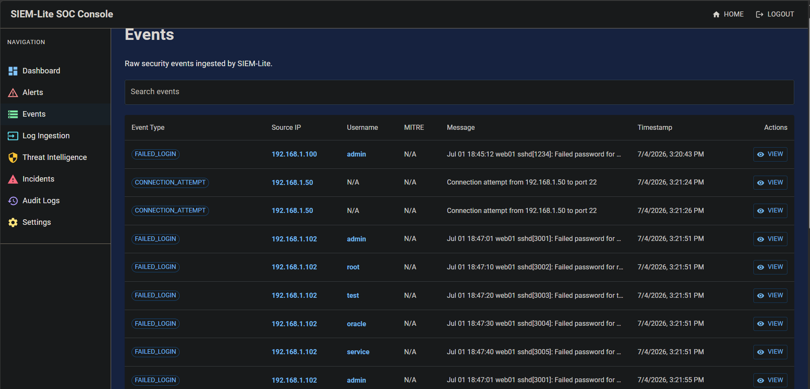
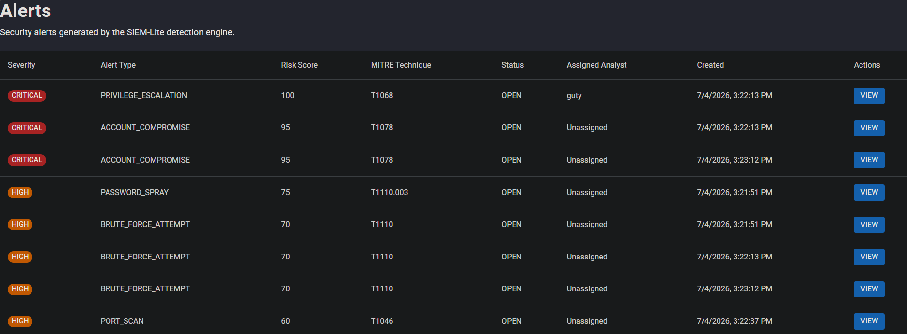
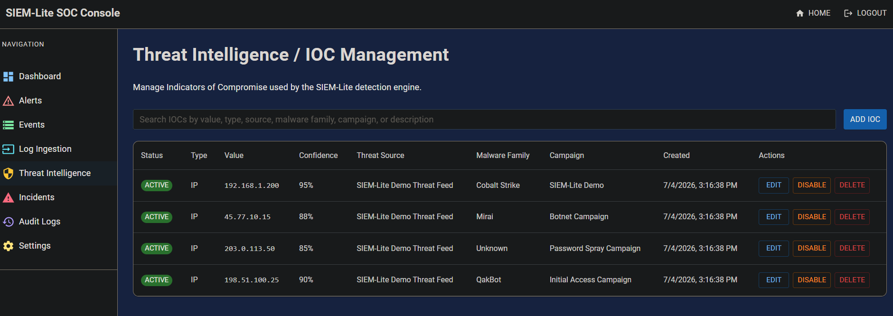
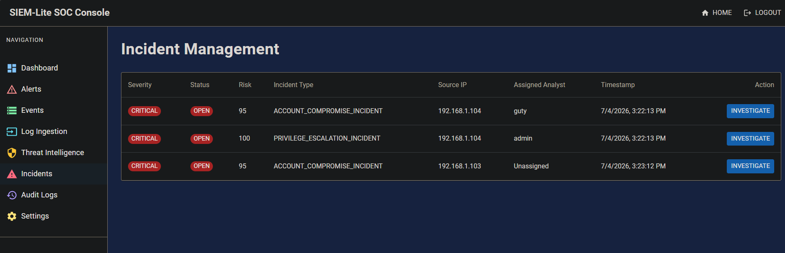
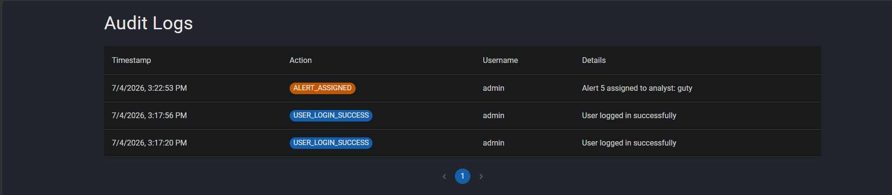

# SIEM-Lite

> A modern Security Information and Event Management (SIEM) platform built with **Spring Boot**, **React**, and **TypeScript**.

---

## Overview

SIEM-Lite simulates the core workflow of a modern Security Operations Center (SOC), demonstrating how raw security logs are transformed into actionable intelligence through parsing, detection rules, threat intelligence enrichment, alert generation, incident correlation, and analyst workflows.

The project is a practical cybersecurity portfolio application inspired by enterprise SIEM platforms such as Microsoft Sentinel, Splunk Enterprise Security, IBM QRadar, and Elastic Security. Rather than focusing on log storage alone, SIEM-Lite emphasizes the complete detection pipeline — from ingestion through investigation — while providing a clean, responsive web interface for analysts.

---

## Table of Contents

- [Features](#features)
- [Technology Stack](#technology-stack)
- [Architecture](#architecture)
- [Detection Pipeline](#detection-pipeline)
- [Screenshots](#screenshots)
- [Getting Started](#getting-started)
- [Detection Rules](#detection-rules)
- [MITRE ATT&CK Integration](#mitre-attck-integration)
- [Threat Intelligence](#threat-intelligence)
- [Supported Log Formats](#supported-log-formats)
- [Future Improvements](#future-improvements)
- [Acknowledgments](#acknowledgments)
- [License](#license)

---

## Features

### Authentication & Security

- JWT-based authentication with Spring Security
- Protected REST API endpoints

### Log Ingestion

- Single and bulk log ingestion
- Guided detection scenarios for rapid demonstrations
- Custom `.txt` log file support
- Automatic log parsing and normalization

### Detection Engine

- Failed Login and Successful Login detection
- Brute Force and Aggressive Brute Force detection
- Password Spray and Account Compromise detection
- Privilege Escalation detection
- Port Scan detection
- IOC Match detection

### Threat Intelligence

- Indicator of Compromise database
- Automatic IOC matching
- Threat source attribution
- Malware family tracking
- Confidence scoring

### Alert Management

- Risk scoring and severity classification
- MITRE ATT&CK mapping
- Analyst assignment
- Status tracking
- Investigation notes

### Incident Management

- Automatic alert correlation into incidents
- Incident tracking
- Analyst workflow support

### Dashboard

- Security event, alert, and incident metrics
- Severity and event type distribution charts
- MITRE ATT&CK and threat intelligence breakdowns
- Recent activity feed

### Audit Logging

- Analyst action history
- Investigation audit trail

---

## Technology Stack

### Backend

| Technology | Purpose |
|---|---|
| Java 25 | Runtime |
| Spring Boot | Application framework |
| Spring Security + JWT | Authentication |
| Spring Data JPA + Hibernate | Data persistence |
| H2 Database | In-memory database |
| Maven | Build tool |
| Swagger / OpenAPI | API documentation |

### Frontend

| Technology | Purpose |
|---|---|
| React + TypeScript | UI framework |
| Vite | Build tooling |
| Material UI | Component library |
| Axios | HTTP client |
| React Router | Client-side routing |

---

## Architecture

SIEM-Lite follows a modular pipeline that transforms raw log data into actionable security incidents.

```text
+----------------------+
|    Log Sources       |
| (SSH, Network, etc.) |
+----------+-----------+
           |
           v
+----------------------+
|    Log Ingestion     |
|  Single / Bulk Logs  |
+----------+-----------+
           |
           v
+----------------------+
|     Log Parser       |
+----------+-----------+
           |
           v
+----------------------+
|   Security Events    |
+----------+-----------+
           |
           v
+----------------------+
|  Detection Engine    |
+----------+-----------+
           |
           v
+----------------------+
| Threat Intelligence  |
|    IOC Matching      |
+----------+-----------+
           |
           v
+----------------------+
|   Alert Generation   |
+----------+-----------+
           |
           v
+----------------------+
| Correlation Engine   |
+----------+-----------+
           |
           v
+----------------------+
|      Incidents       |
+----------+-----------+
           |
           v
+----------------------+
| Dashboard & Audit Log|
+----------------------+
```

---

## Detection Pipeline

Every log follows the same consistent processing flow, ensuring complete traceability from the original log entry through analyst investigation.

```text
Raw Log
   ↓
Parser
   ↓
Security Event
   ↓
Detection Engine
   ↓
Threat Intelligence / IOC Matching
   ↓
Alert
   ↓
Correlation Engine
   ↓
Incident
   ↓
Dashboard
   ↓
Audit Log
```

---

## Screenshots

### Dashboard

The SOC dashboard gives analysts a real-time overview of security events, alerts, incidents, MITRE ATT&CK distribution, threat intelligence metrics, and recent activity.



### Log Ingestion

Supports single log ingestion, guided detection scenarios, and bulk processing via uploaded `.txt` files.



### Security Events

Parsed events are normalized and displayed with event type, source IP, username, timestamp, and raw log message.



### Alerts

Alerts include severity, risk score, MITRE ATT&CK mappings, analyst assignment, and investigation notes.



### Threat Intelligence

The Threat Intelligence module manages IOCs with confidence scoring, malware family attribution, and campaign tracking.



### Incidents

Related alerts are automatically correlated into incidents, giving analysts a higher-level view of malicious activity.



### Audit Logs

All analyst actions are recorded to provide accountability and investigation traceability.



---

## Getting Started

### Prerequisites

- Java 25
- Maven
- Node.js 24+
- npm
- Git

### Clone the Repository

```bash
git clone https://github.com/guty09/siem-lite.git
cd siem-lite
```

### Start the Backend

From the project root:

```bash
mvn spring-boot:run
```

The backend will be available at:

```text
http://localhost:8081
```

### Start the Frontend

In a separate terminal:

```bash
cd frontend
npm install
npm run dev
```

The frontend will be available at:

```text
http://localhost:5173
```

### Swagger API Documentation

With the backend running, visit:

```text
http://localhost:8081/swagger-ui/index.html
```

---

## Detection Rules

| Detection Rule | Severity | Creates Incident |
|---|---|:---:|
| Failed Login | Medium | ❌ |
| Successful Login | Informational | ❌ |
| Brute Force | High | ❌ |
| Aggressive Brute Force | Critical | ✅ |
| Password Spray | High | ❌ |
| Account Compromise | Critical | ✅ |
| Privilege Escalation | Critical | ✅ |
| Port Scan | High | ❌ |
| IOC Match | Critical | ✅ |

---

## MITRE ATT&CK Integration

SIEM-Lite enriches supported detections with MITRE ATT&CK tactics and techniques to provide analysts with additional investigation context.

MITRE ATT&CK mappings are displayed within alerts and dashboard visualizations, helping analysts understand attacker behavior and prioritize response efforts.

Examples of detections enriched with MITRE ATT&CK context include:

- Brute Force
- Password Spray
- Account Compromise
- Privilege Escalation
- IOC Match

---

## Threat Intelligence

The Threat Intelligence module maintains Indicators of Compromise and automatically checks parsed security events against known malicious indicators.

When an IOC match is detected, SIEM-Lite generates a high-severity alert and correlates it into an incident.

### Seeded Demo IOC IPs

- `192.168.1.200`
- `45.77.10.15`
- `203.0.113.50`
- `198.51.100.25`

### Supported IOC Types

- `IP`
- `DOMAIN`
- `URL`
- `FILE_HASH`

---

## Supported Log Formats

### Failed Login

```text
Jul 01 18:45:12 web01 sshd[1234]: Failed password for admin from 192.168.1.100 port 51422 ssh2
```

### Successful Login

```text
Accepted password for admin from 192.168.1.100
```

### Privilege Escalation

```text
sudo command executed by admin from 192.168.1.104
```

### Connection Attempt

```text
Connection attempt from 192.168.1.50 to port 22
```

### IOC Demo Logs

```text
Jul 01 19:00:00 web01 sshd[9001]: Failed password for admin from 192.168.1.200 port 60001 ssh2
Jul 01 19:05:10 web01 sshd[9002]: Failed password for backup from 45.77.10.15 port 52331 ssh2
Jul 01 19:10:14 web01 sshd[9003]: Failed password for root from 203.0.113.50 port 40022 ssh2
Jul 01 19:15:44 web01 sshd[9004]: Failed password for deploy from 198.51.100.25 port 44444 ssh2
```

Expected IOC flow:

```text
Raw Log
   ↓
Security Event
   ↓
IOC_MATCH Alert
   ↓
IOC_MATCH Incident
```

---

## Future Improvements

- Support for additional log sources such as Syslog and Windows Event Logs
- Persistent database support with PostgreSQL or MySQL
- Real-time log streaming
- Email and webhook alert notifications
- Advanced correlation rules
- Role-based access control
- Dashboard customization
- Docker Compose production deployment

---

## Acknowledgments

SIEM-Lite was inspired by enterprise SIEM platforms including Microsoft Sentinel, Splunk Enterprise Security, IBM QRadar, and Elastic Security.

This project was developed as a cybersecurity portfolio application to demonstrate SOC workflows, detection engineering, threat intelligence, incident correlation, and analyst investigation concepts.

---

## License

This project is licensed under the [MIT License](LICENSE).